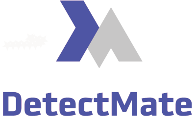

# DetectMateLibrary



DetectMate is a flexible, component-based library for parsing and log anomaly detection.

## Installation

Download us from `Pip`!!

```bash
pip install detectmatelibrary
```

## Documentation

Main documentations:

- [Library Documentation](https://ait-detectmate.github.io/DetectMateLibrary/latest/) (this repo)
- [Service Documentation](https://github.com/ait-detectmate/DetectMateService/tree/main)

## Contribution

We're happily taking patches and other contributions. Please see the following links for how to get started:

- [GitHub Workflow](https://ait-detectmate.github.io/DetectMateLibrary/latest/contribution/)

If you encounter any bugs, please create an issue on [Github](https://github.com/ait-detectmate/DetectMateLibrary/issues).

## License

[EUPL-1.2](https://github.com/ait-detectmate/DetectMateLibrary/blob/main/LICENSE.md)
