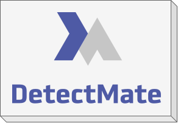

# DetectMateLibrary



DetectMate is a flexible, component-based library for log parsing and anomaly detection.

## Installation

Install the package with pip.

```bash
pip install detectmatelibrary
```

## Documentation

- [Library Documentation](https://ait-detectmate.github.io/DetectMateLibrary/latest/) (this repo)
- [Service Documentation](https://ait-detectmate.github.io/DetectMateService/latest/)

## Contribution

We welcome patches and other contributions. The GitHub workflow explains how to get started.

- [GitHub Workflow](https://ait-detectmate.github.io/DetectMateLibrary/latest/contribution/)

If you find a bug, please open an issue. [GitHub Issues](https://github.com/ait-detectmate/DetectMateLibrary/issues)

## License

[EUPL-1.2](https://github.com/ait-detectmate/DetectMateLibrary/blob/main/LICENSE.md)
