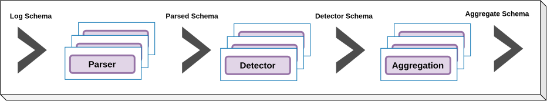
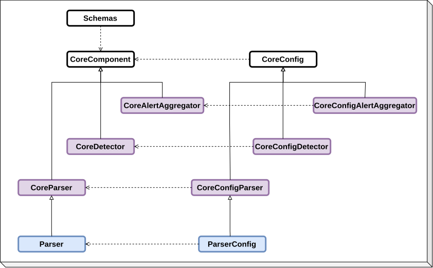
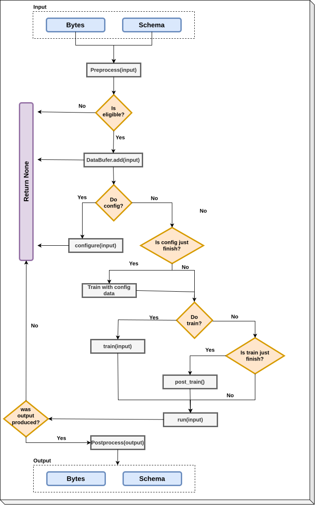

# Overall architecture

In this section, we outline the overall architecture of the DetectMate Components.


## How things work and where data goes

This document describes the high-level design of the DetectMateLibrary, how components interact, the data contracts they use, and guidance for deploying and extending the system. The library is built around small, composable components that operate on streaming log data and exchange strongly-typed Schema objects.

Key goals:

- Clear separation of concerns (reading, parsing, detection, output).
- Stream-friendly processing with minimal buffering.
- Well-defined schema contracts so components can be composed or run as microservices.
- Easy extensibility: add new readers, parsers or detectors by subclassing core base classes.

## Components flow

The pipeline is strictly directional:

- Parser: consumes raw logs and produces parsed log objects (structured fields, timestamps, variables).
- Detector: consumes parsed logs and generates alerts/findings when rules or models match anomalous behavior.
- Alert Aggregation: consumes alerts and aggregates them.

Each arrow represents a stream of Schema objects. Components are designed to run in the same process for lightweight setups or as separate services for scalable deployments.



## Components architecture

All components inherit from the `CoreComponent` class. This class provides all the essential functionality required for DetectMate to operate (see UML diagram below). Every `Detector` must inherit from `CoreDetector`, every `AlertAggregator` must inherit from `CoreAlertAggregator` and every `Parser` must inherit from `CoreParser` to ensure compatibility with DetectMate.

Each component's arguments must be stored in its corresponding configuration class. These config classes follow the same design pattern as their components and must inherit from `CoreConfig`.




??? note "Main Components"

    | Component | Info | Inherits from |
    |-----------| ---- | ---- |
    | [CoreComponent](https://github.com/ait-detectmate/DetectMateLibrary/blob/main/src/detectmatelibrary/common/core.py) | Main class of DetectMate. | `None` |
    | [CoreParser](https://github.com/ait-detectmate/DetectMateLibrary/blob/main/src/detectmatelibrary/common/parser.py) | Main class of all the parsers. | `CoreComponent` |
    | [CoreDetector](https://github.com/ait-detectmate/DetectMateLibrary/blob/main/src/detectmatelibrary/common/detector.py) | Main class of all the detectors. | `CoreComponent` |
    | [CoreAlertAggregator](https://github.com/ait-detectmate/DetectMateLibrary/blob/main/src/detectmatelibrary/common/alert_aggregator.py) | Main class of all the alert aggregators. | `CoreComponent` |
    | [DeepLearningDetector](https://github.com/ait-detectmate/DetectMateLibrary/blob/main/src/detectmatelibrary/base_detectors/deeplearning_detector.py) | Main class used in deep learning detectors. | `CoreDetector` |
    | [TrackerDetector](https://github.com/ait-detectmate/DetectMateLibrary/blob/main/src/detectmatelibrary/base_detectors/tracker_detector.py) | Main class used in detectors that use `EventPersistency`. | `CoreDetector` |
    | [VariableDetector](https://github.com/ait-detectmate/DetectMateLibrary/blob/main/src/detectmatelibrary/base_detectors/variable_detector.py) | Main class used in detectors that learn variables. | `TrackerDetector` |
    | [DensityClusteringAggregation](https://github.com/ait-detectmate/DetectMateLibrary/blob/main/src/detectmatelibrary/base_alert_aggregation/density_clustering.py) | Density aggregators.| `CoreAlertAggregator` |

## Process flow

The `process` method is the primary method used by every component during inference. It executes all required steps in the background to ensure the component behaves as expected. The diagram below illustrates the overall structure. This method accepts either a schema or a serialized schema as input and returns an output schema, a serialized schema, or `None`.

The process flow is made up of the following stages:

* **Preprocess**: If the input arrives as bytes, it is deserialized and converted into a schema. If a schema is provided instead, the system creates a copy to prevent modifying the original input.
* **Eligible**: Verify whether the input qualifies for this component. For example, an input with an invalid logSource will be ignored by a particular parser.
* **DataBuffer**: Handles the data according to what the component specifies. Additional details are available here.
* **Configuration**: A step that happens before training, enabling the method to automatically set its hyperparameters.
* **Train**: The part responsible for fitting/training the method.
* **Run**: Executes the primary inference routine for each component.
* **Postprocessing**: Transforms the output schema back into bytes when the original input was provided as bytes.




## Components methods

Each Core* base class exposes a small, stable API that implementations must implement or may override.

```python title="Component methods"
--8<-- "docs/examples/others/components_methods.py:read"
```
