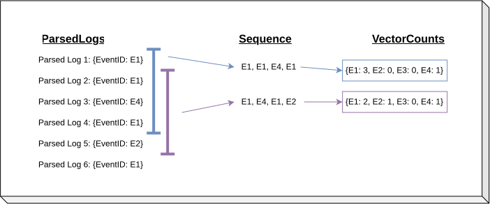

# ECVC Detector [[Code](https://github.com/ait-detectmate/DetectMateLibrary/blob/main/src/detectmatelibrary/detectors/ecvc_detector.py)]

The Event Count Vector Clustering Detector (ECVC) detects anomalies by calculating the distance between the count vectors from training and new ones.

\[
score = min(\{\frac{\sum_{i=0}^{n-1} |\hat{cv_i} - W_{i,j}|}{\sum_{i=0}^{n-1} max(\hat{cv_i}, W_{i,j})} | j \in \mathbb{N}, j < m\})
\]

Here, \( \hat{cv_i} \) denotes the incoming vector count, and \( W_{i,j} \) represents the matrix containing all training vector counts. A new \( \hat{cv_i} \) is classified as anomalous if its score exceeds a chosen threshold.

The method can be found in [this publication](https://dl.acm.org/doi/10.1145/3660768).

### Count Vector

To build a count vector, we first collect the event IDs and arrange them into sequences. Each fixed-size sequence is then processed to produce a count vector that records how many times each event ID occurs in total. If an event ID does not appear, its count is set to 0.




The count vector cv is defined as:

\[
cv_i = \sum_{j=1}^{n} \mathbf{1}(x_j = event\_id_i)
\]

Where \(event\_id_i\) represents the event id constant value of that position in the vector and \( x_j\) the event id of the sequence in position j.


## In/out

Input and output schemas in the pipeline

|            | Schema                     | Description        |
|------------|----------------------------|--------------------|
| **Input**  | [ParserSchema](../schemas.md) | Structured log  |
| **Output** | [DetectorSchema](../schemas.md) | Alert / finding |

## At a glance

| Learns from training data | Auto-configuration | Needs `events` | Federation |
|---|---|---|---|
| ✅ | ❌ | ❌ | ✅ |

## Description

Count vectors learned during training are stored via [persistency](../auxiliar/persistency.md), so a trained model can be saved and restored with a `persist:` block. A count vector is only comparable within the window it was counted over, so restoring state at a different `window_size` logs a warning, because the restored vectors cannot match and every window would alert.


## Example

```python
--8<-- "docs/examples/detectors/ecvc_detector.py:example"
```

## Configuration file

The configuration used by the example above. It sets only what this use case needs; every other parameter keeps its default (see [Configuration arguments](#configuration-arguments)).

```yaml
--8<-- "docs/examples/detectors/ecvc_detector.yaml"
```

The same file works unchanged in both places a detector runs:

- **Library**: load it with `yaml.safe_load` and pass the dict as `config=`, as in the example. The key under `detectors:` must match the detector's `name`.
- **[DetectMateService](https://github.com/ait-detectmate/DetectMateService)**: use it as the service's detector configuration.

## Configuration arguments

All parameters this detector accepts, grouped by the YAML block they go in. **Scope** tells whether a parameter is `specific` to this detector or `shared` with other detectors (see the [Detectors overview](../detectors.md#common-parameters-all-detectors)). Where this detector changes a shared default, the shared value is shown in brackets.

<!-- Start arguments -->
??? note "Top level"

    | Field | Type | Default | Scope | Description |
    |---|---|---|---|---|
    | `method_type` | string | ecvc_detector | shared | Indicates what type of method it is. |
    | `auto_config` | boolean | True | shared | Runs the configuration step before the training process. Has no effect unless data_use_configure is set. |
    | `events` | object | {} | shared | Events configuration dict keyed by event_id. |
    | `global` | object | {} | shared | Instances monitoring event-independent header variables (e.g. hostname, level), keyed by instance name. Written as `global` in YAML. |
    | `persist` | object, null | None | shared | Periodic state saving (path, interval_seconds, events_until_save, auto_load, storage_options). None disables it. See Saving state (persist) on the Detectors page. |

???+ note "params"

    | Field | Type | Default | Scope | Description |
    |---|---|---|---|---|
    | `window_size` | integer | 10 | specific | Length of the event-ID window a count vector is built over. |
    | `validation_per` | number | 0.2 | specific | Fraction of the learned count vectors held out as a validation split and used to derive the anomaly threshold. |
    | `seed` | integer | 0 | specific | Random seed used to shuffle count vectors into train/validation splits. |
    | `threshold_method` | string | mean | specific | Method used to derive the anomaly threshold from the validation split: 'mean' averages the distance scores, 'default' uses a fixed threshold of 0. |
    | `start_id` | integer | 10 | shared | Number used to start the unique ID generator. |
    | `data_use_training` | integer, null | None | shared | Number of logs used for training. None skips training. |
    | `data_use_configure` | integer, null | None | shared | Number of logs used for the configuration step. None skips it. |
    | `use_config_data_as_training` | boolean | True | shared | Combine the configured data in the training process if True. |
    | `train_buffer_max_records` | integer | 100000 | shared | Configure records kept in memory for training (use_config_data_as_training) before the buffer spills to Parquet files on disk, in parts of this many records. |
    | `train_buffer_dir` | string, null | None | shared | Local directory for the spilled training buffer. None uses the system temp directory (TMPDIR). Each spill goes to a private detectmate-train-* directory, removed after training reads it; a killed process leaves it behind. |
    | `connector_name` | string, null | None | shared | Add a connector in the output schema. |
    | `connector_url` | string, null | None | shared | Setup the url of the connector in the output schema. |
    | `parser` | string | PARSER | shared | Name of the parser used. |
    | `allow_fed` | boolean | False | shared | Builds the stores needed to take part in federation. |
<!-- End arguments -->
