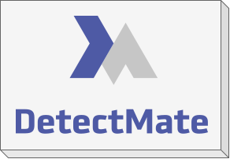
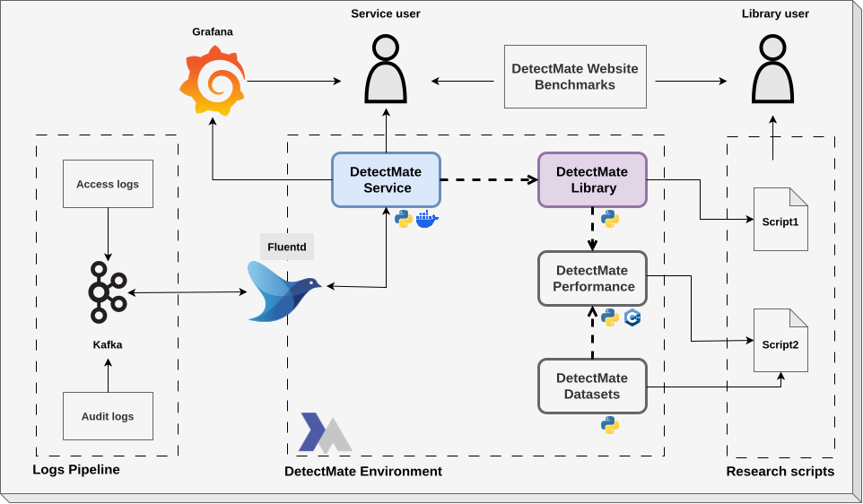

# DetectMate Library

DetectMate is a flexible, component-based library for log parsing and anomaly detection. You can use the library in research and production and deploy it in a microservice architecture with DetectMate Service. [DetectMate Service](https://ait-detectmate.github.io/DetectMateService/latest/)

The diagram shows how the DetectMate components interact. The Service supports deployment without custom code. The Library lets developers integrate the components into their own scripts.

## User Guide

Start here if you are new to the library and want a quick overview of what it can do and where it fits.

* [What is DetectMate?](user_guide/what_is_detectmate.md)
* [Installation](user_guide/installation.md)
* [Basic knowledge](user_guide/basic_knowledge.md)
* [Quickstart](user_guide/quickstart.md)

## Advanced Guide

* [Overall architecture](advanced/overall_architecture.md)
* [Schemas](schemas.md)
* [Parsers](parsers.md)
* [Detectors](detectors.md)
* [Alert Aggregation](alert_aggregator.md)
* [Pipelines](pipeline.md)
* [Federation](federation.md)

## How to contribute

* [Contributing](contribution.md)
* [Development](development.md)
* [Release Process](release.md)
