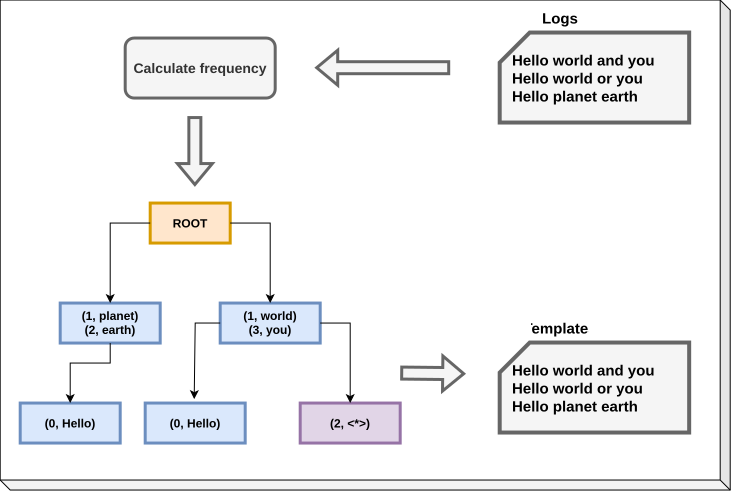

# Brain Parser [[Code](https://github.com/ait-detectmate/DetectMateLibrary/blob/main/src/detectmatelibrary/parsers/brain.py)]

Brain uses the DetectMatePerformance implementation, which also provides a batch API for mining templates from large collections of logs. [DetectMatePerformance](https://github.com/ait-detectmate/DetectMatePerformance)

## In/out

Input and output schemas in the pipeline

|            | Schema                        | Description      |
|------------|-------------------------------|------------------|
| **Input**  | [LogSchema](../schemas.md)    | Unstructured log |
| **Output** | [ParserSchema](../schemas.md) | Structured log   |

| Learns from training data | Auto-configuration | Needs `events` | Federation |
|---|---|---|---|
| ✅ | ✅ | ❌ | ✅ |

## Description

The original Brain algorithm looks for the longest common pattern in a log message by grouping tokens with the same frequency. Messages with the same length and pattern form an initial group. A bidirectional tree finds additional fixed tokens outside that pattern to complete the template. [Brain paper](https://ieeexplore.ieee.org/abstract/document/10109145)



In DetectMate, Brain builds templates when training ends. It counts how often each token appears at a given position across the buffered logs. For each message, Brain considers tokens whose count is at least `weight` times the highest count among that message’s tokens. It chooses the largest group of eligible tokens that share a count. If two groups have the same size, it picks the one with the higher count.

Brain groups messages that have the same token count and the same selected tokens at the same positions. It checks every position in each group, keeping tokens that agree across all messages and writing `<*>` where they vary. In the first training round below, `hello`, `there`, and `kenobi` each occur twice in their respective positions. The varying rank becomes a wildcard in `hello there <*> kenobi`. After training, the tree matcher returns that template for `hello there, sergeant kenobi!` and puts `sergeant` in `variables`.

### Federation

Brain inherits the concatenation strategy from `ParserGenerator`. Aggregation collects the templates learned by each participating parser, removes duplicates, and sorts the result. Each participant builds its matcher from that shared list, giving the same template the same `eventID` across the federation. [Drain federation](drain_parser.md#federation) · [Distributed parsing paper, Section 4.3.1](https://arxiv.org/pdf/2610.36946#page=6)

!!! warning "Training after federation"
    When retraining finishes, the parser replaces the federated template set with templates generated
    from its local training buffer. Templates learned only by other participants are lost.

## Examples

By default, Brain keeps earlier training logs when training resumes.

```python title="Example"
--8<-- "docs/examples/parsers/brain.py:example_1"
```

Run this after the first example to clear the training buffer after each round with `reset_in_post_train: true`. Once retraining finishes, the new template matches and the earlier template is gone.

```python title="Reset example"
--8<-- "docs/examples/parsers/brain.py:example_2"
```

## Configuration file

This file sets the initial training size to two logs. See [Configuration arguments](#configuration-arguments) for the remaining defaults.

```yaml title="Configuration"
--8<-- "docs/examples/parsers/brain.yaml"
```

- **Library**. Load this file with `yaml.safe_load` and pass the result as `config=`. The key under `parsers` must match the parser's `name`.
- **DetectMateService**. Use this file as the component configuration with a library version that includes Brain. In the service settings, set `component_type` to `parsers.brain.BrainParser` and `component_config_class` to `parsers.brain.BrainConfig`. [DetectMateService](https://github.com/ait-detectmate/DetectMateService)

## Configuration arguments

Arguments are grouped by YAML block. **Scope** identifies fields specific to Brain and fields inherited from the parser generator base. When Brain overrides an inherited default, the base default appears in parentheses. [Shared parser generator parameters](../parsers.md#parser-generators)

<!-- Start arguments -->
??? note "Top level"

    | Field | Type | Default | Scope | Description |
    |---|---|---|---|---|
    | `method_type` | string | brain_parser | shared | Indicates what type of method it is. |
    | `auto_config` | boolean | False | shared | Runs the configuration step before the training process. |

???+ note "params"

    | Field | Type | Default | Scope | Description |
    |---|---|---|---|---|
    | `weight` | number | 0.5 | specific | Multiplier on the highest token frequency in a log to set the clustering cutoff. |
    | `start_id` | integer | 10 | shared | Number used to start the unique ID generator. |
    | `data_use_training` | integer, null | None | shared | Number of logs used for training. None skips training. |
    | `data_use_configure` | integer, null | None | shared | Number of logs used for the configuration step. None skips it. |
    | `use_config_data_as_training` | boolean | True | shared | Reuse configuration records as training data. |
    | `train_buffer_max_records` | integer | 100000 | shared | Configure records kept in memory for training (use_config_data_as_training) before the buffer spills to Parquet files on disk, in parts of this many records. |
    | `train_buffer_dir` | string, null | None | shared | Local directory for the spilled training buffer. None uses the system temp directory (TMPDIR). Each spill goes to a private detectmate-train-* directory, removed after training reads it; a killed process leaves it behind. |
    | `connector_name` | string, null | None | shared | Add a connector to the output schema. |
    | `connector_url` | string, null | None | shared | Set up the URL of the connector for the output schema. |
    | `log_format` | string, null | None | shared | Pattern with named fields such as `<Time>` and `<Content>` for splitting a raw log. |
    | `time_format` | string, null | None | shared | Format used to parse the timestamp field. |
    | `log_source` | string, null | None | shared | Process only inputs of the same log source. |
    | `reset_in_post_train` | boolean | False | shared | Clear buffered training logs after generating templates. |
    | `Finetune` | array | [['weight', [0.5, 1.0, 1.5]]] (shared: []) | shared | Candidate [parameter, values] pairs for automatic configuration. |
<!-- End arguments -->
