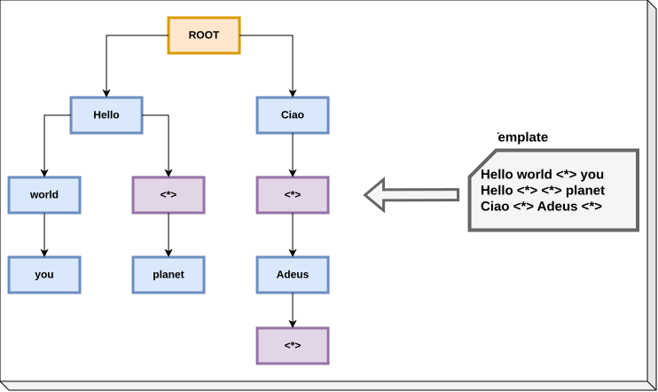

# Template Tree Matcher [[Code](https://github.com/ait-detectmate/DetectMateLibrary/blob/main/src/detectmatelibrary/parsers/tree_matcher.py)]

The Template Tree Matcher matches incoming logs against predefined templates and extracts variable values. DetectMatePerformance provides the underlying tree matcher and a batch matching API. [DetectMatePerformance](https://github.com/ait-detectmate/DetectMatePerformance)

## In/out

Input and output schemas in the pipeline

|            | Schema                     | Description        |
|------------|----------------------------|--------------------|
| **Input**  | [LogSchema](../schemas.md) | Unstructured log   |
| **Output** | [ParserSchema](../schemas.md) | Structured log   |

| Learns from training data | Auto-configuration | Needs `events` | Federation |
|---|---|---|---|
| ❌ | ❌  | ❌  | ❌ |

!!! warning "Not yet stable"
    This parser is not yet in a stable release and may behave differently across platforms or hardware.

## Description

When the method starts, the matcher loads the template list from `params.path_templates`. It builds a tree where every template corresponds to a path, and any templates sharing the same leading tokens also share the same initial nodes. If `path_templates` isn’t provided, the matcher begins with an empty tree.

In both templates and incoming log lines, punctuation such as `=`, `:`, and quotation marks separates tokens. Matching is case-sensitive, and a path such as `/srv/app` stays a single token. A `<*>` edge captures tokens until the next fixed token appears, and a trailing wildcard captures all remaining tokens. A match succeeds when it consumes the full message and reaches the end of a template path.



When the search fails, `eventID` is `-1` and `template` is `template not found`. The `variables` list can contain tokens captured before the failure.

## Template format

Put one template on each line of a plain-text file and use `<*>` for variable text. Consecutive wildcard tokens are combined into one.

```text title="templates.txt"
pid=<*> uid=<*> auid=<*> ses=<*> msg='op=PAM:<*> acct=<*>
login success: user=<*> source=<*>
login failure: reason=<*> code=<*>
```

The two `login` templates share a node and then follow different paths.

```text
login
├── success → user → <*> → source → <*>
└── failure → reason → <*> → code → <*>
```

The message `login failure: reason=timed out code=17` matches the third template. The parser returns `2` for `eventID`, `login failure reason <*> code <*>` for `template`, and `["timed", "out", "17"]` for `variables`.

## Example

```python title="Example"
--8<-- "docs/examples/parsers/template_tree_matcher.py:example"
```

## Configuration file

The configuration used by the example above. It sets only what this use case needs; every other parameter keeps its default (see [Configuration arguments](#configuration-arguments)).

```yaml title="Configuration"
--8<-- "docs/examples/parsers/template_tree_matcher.yaml"
```

The same file works unchanged in both places a parser runs:

- **Library**: load it with `yaml.safe_load` and pass the dict as `config=`, as in the example. The key under `parsers:` must match the parser's `name`.
- **[DetectMateService](https://github.com/ait-detectmate/DetectMateService)**: use it as the service's parser configuration.

## Configuration arguments

All parameters this parser accepts, grouped by the YAML block they go in. **Scope** tells whether a parameter is `specific` to this parser or `shared` with other parsers (see the [Parsers overview](../parsers.md#common-parameters-all-parsers)).

<!-- Start arguments -->
??? note "Top level"

    | Field | Type | Default | Scope | Description |
    |---|---|---|---|---|
    | `method_type` | string | tree_matcher | shared | Indicates what type of method it is. |
    | `auto_config` | boolean | False | shared | Runs the configuration step before the training process. |

???+ note "params"

    | Field | Type | Default | Scope | Description |
    |---|---|---|---|---|
    | `path_templates` | string, null | None | specific | Path to a plain-text file containing one template per line. |
    | `start_id` | integer | 10 | shared | Number used to start the unique ID generator. |
    | `data_use_training` | integer, null | None | shared | Number of logs used for training. None skips training. |
    | `data_use_configure` | integer, null | None | shared | Number of logs used for the configuration step. None skips it. |
    | `use_config_data_as_training` | boolean | True | shared | Reuse configuration records as training data. |
    | `train_buffer_max_records` | integer | 100000 | shared | Configure records kept in memory for training (use_config_data_as_training) before the buffer spills to Parquet files on disk, in parts of this many records. |
    | `train_buffer_dir` | string, null | None | shared | Local directory for the spilled training buffer. None uses the system temp directory (TMPDIR). Each spill goes to a private detectmate-train-* directory, removed after training reads it; a killed process leaves it behind. |
    | `connector_name` | string, null | None | shared | Add a connector to the output schema. |
    | `connector_url` | string, null | None | shared | Set up the URL of the connector for the output schema. |
    | `log_format` | string, null | None | shared | Pattern with named fields such as `<Time>` and `<Content>` for splitting a raw log. |
    | `time_format` | string, null | None | shared | Format used to parse the timestamp field. |
    | `log_source` | string, null | None | shared | Process only inputs of the same log source. |
<!-- End arguments -->
